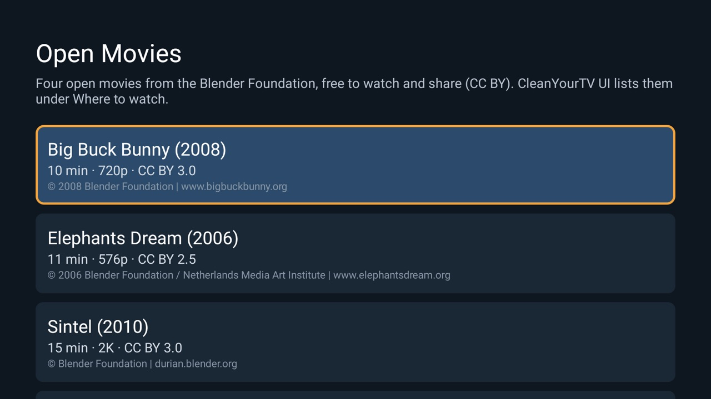

# Open Movies (watch provider example)

The reference [watch provider](../../docs/providers.md): a small app that tells CleanYourTV UI which films it can
play, so they show up under **Where to watch**. It follows the contract in
[`docs/specs/provider.md`](../../docs/specs/provider.md) and is not a module card. It has only four films, the open
movies of the Blender Foundation, all shared under Creative Commons Attribution (CC BY), so the example works
without any account or subscription.



## How it answers

CleanYourTV UI asks the provider about the film whose page is open. The provider answers from a built-in list:

| Film | TMDB | IMDb | Year | Quality | Licence |
|---|---|---|---|---|---|
| Big Buck Bunny | 10378 | tt1254207 | 2008 | 720p | CC BY 3.0 |
| Elephants Dream | 9761 | tt0807840 | 2006 | 576p | CC BY 2.5 |
| Sintel | 45745 | tt1727587 | 2010 | 2K | CC BY 3.0 |
| Tears of Steel | 133701 | tt2285752 | 2012 | 720p | CC BY 3.0 |

A request matches in this order, and only for movies (a TV show gets no items):

1. `ids.tmdb`.
2. `ids.imdb`, ignoring case.
3. The `title` or `original_title`, with accents, case and punctuation ignored, when the `year` is missing or
   within one year of the film's.

A match gets one item that opens the full-screen player of this app:

```json
{"v":1,"items":[{"label":"Watch","detail":"CC BY · 720p","action":"play","uri":"openmovies://play?tmdb=10378"}]}
```

No match gets `{"v":1,"items":[]}`. A newer `v` or fields it does not know are not an error.

## Permissions

| Permission | Why |
|---|---|
| `INTERNET` | Streams the films from archive.org and download.blender.org, only while one is playing. |

That is all. No accounts, no telemetry, no ads, no background service. `call()` answers from the built-in
list and never uses the network.

## Build and install

JDK 17 and Android SDK platform 34 with build-tools 34.0.0, as for the launcher. One command builds and installs:

```bash
TV_HOST=<tv ip> addons/watch-provider-example/install.sh
```

Or by hand:

```bash
cd addons/watch-provider-example && ./gradlew assembleRelease
TV_HOST=<tv ip> ../../tools/venv/bin/python -I ../../tools/tv.py --push app/build/outputs/apk/release/app-release.apk /data/local/tmp/addon.apk
TV_HOST=<tv ip> ../../tools/venv/bin/python -I ../../tools/tv.py 'pm install -r /data/local/tmp/addon.apk; rm -f /data/local/tmp/addon.apk'
```

The release build is signed with the debug key so it installs over ADB like the launcher. Sign your own builds
with your own key if you hand them out.

## Try it with CleanYourTV UI

Follow the steps in [`docs/providers.md`](../../docs/providers.md): open the page of one of the four films, for
example Big Buck Bunny, find **Where to watch**, allow **Open Movies**, and choose **Watch**.

## Try it without CleanYourTV UI

Open Movies is in the TV's apps list and shows the four films; pick one to play it. From a computer:

```bash
TV_HOST=<tv ip> tools/venv/bin/python -I tools/tv.py 'am start -a android.intent.action.VIEW -d "openmovies://play?tmdb=10378" io.cleanyourtv.example.openmovies'
```

The provider can be called by hand with `content call`. This command is not yet tested on a device:

```bash
TV_HOST=<tv ip> tools/venv/bin/python -I tools/tv.py "content call --uri content://io.cleanyourtv.example.openmovies.watch --method availability --extra 'request:s:{\"v\":1,\"type\":\"movie\",\"ids\":{\"tmdb\":10378}}'"
```

## Write your own

Start from three places:

- `app/src/main/AndroidManifest.xml`: the `<provider>` with the `io.cleanyourtv.action.WATCH_PROVIDER` filter and its
  `meta-data` pointing at `res/xml/watch_provider.xml`.
- `WatchProvider.java`: `call("availability", ...)` reads `request` from the extras and returns `response`.
- `Availability.java`: the answer as a pure function of the request JSON, which is what `AvailabilityTest` checks.

Replace `Catalog.java` with your own source of films, and `PlayerActivity.java` with whatever plays them.

## Films and licences

- Big Buck Bunny: (c) 2008 Blender Foundation, www.bigbuckbunny.org, CC BY 3.0.
- Elephants Dream: (c) 2006 Blender Foundation / Netherlands Media Art Institute, www.elephantsdream.org, CC BY 2.5.
- Sintel: (c) Blender Foundation, durian.blender.org, CC BY 3.0.
- Tears of Steel: (CC) Blender Foundation, mango.blender.org, CC BY 3.0. Its 720p file has MP3 audio, which may
  play silent on some TV builds; the fallback file is tried if playback fails.

Open movies by the Blender Foundation, www.blender.org, shared under Creative Commons Attribution (CC BY). The
credit is shown in the app's list and when a film is paused. The app's banner and icon are drawn for this
add-on and are not the Blender logo.

## Status

Not yet tested on a real TV.

## Maintainer

[@matheus-caldeira](https://github.com/matheus-caldeira)
